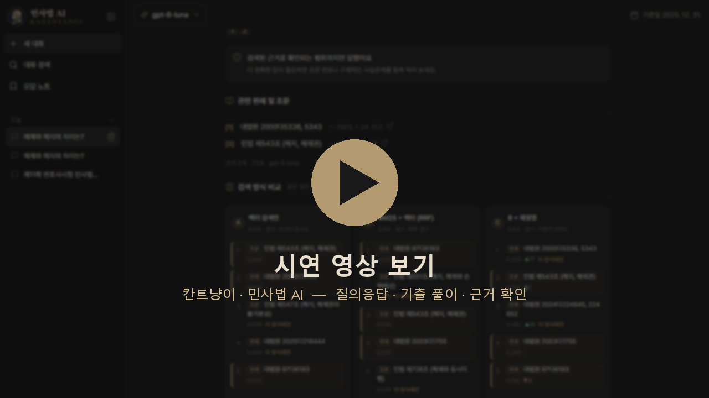
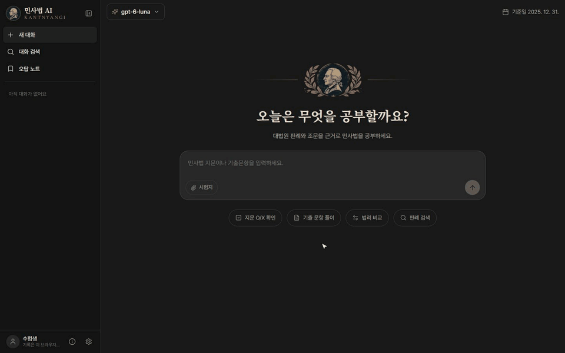
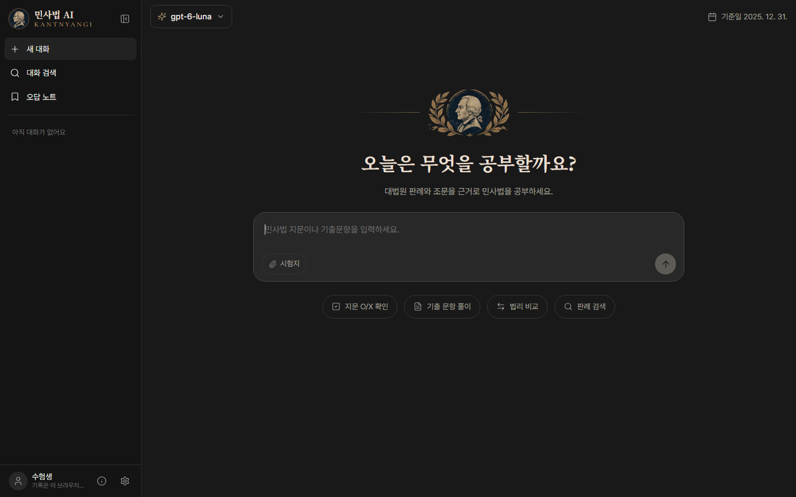
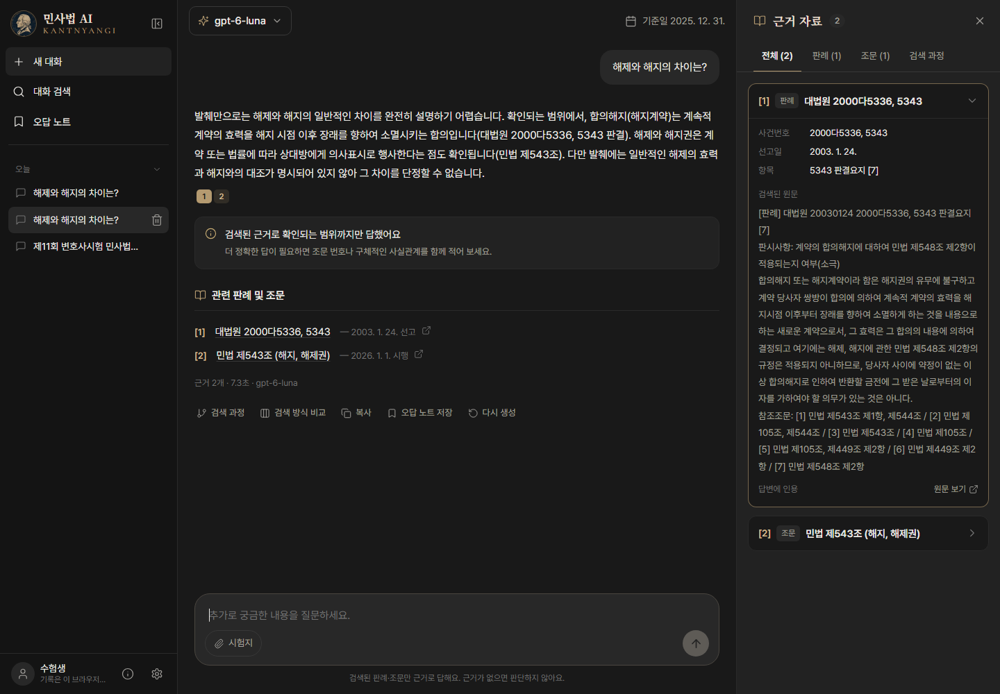
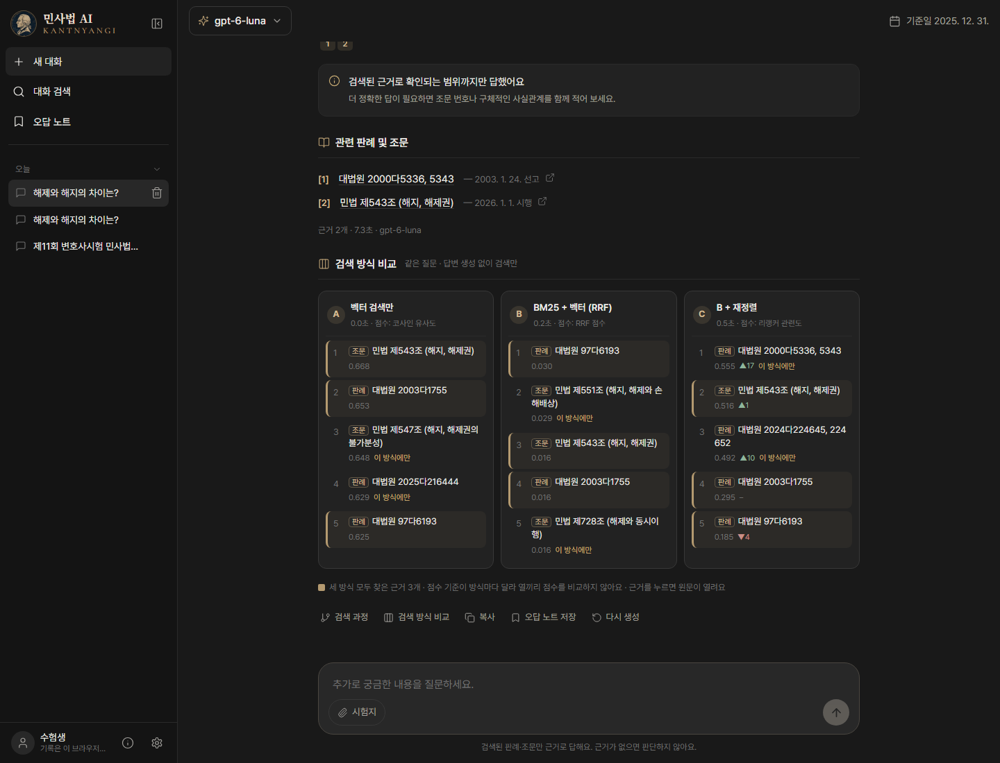
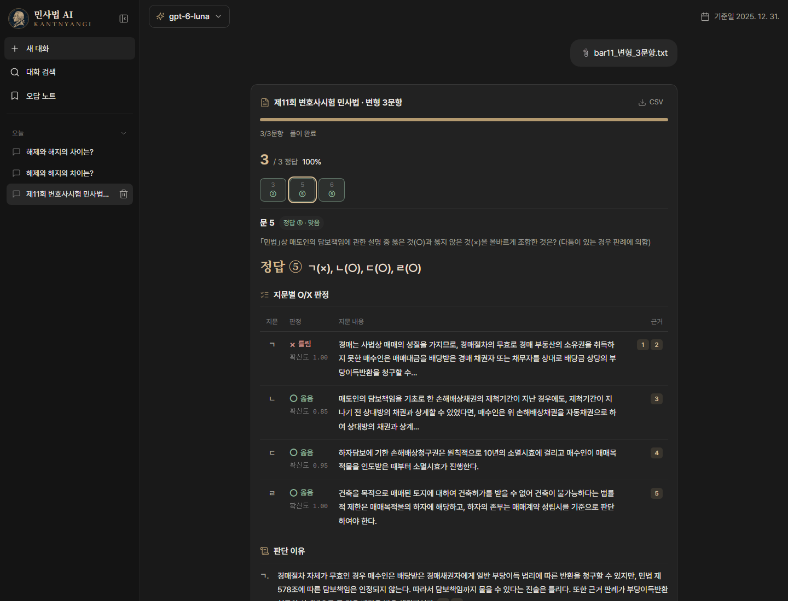
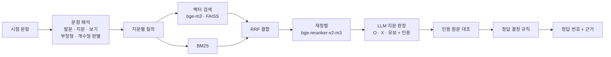

<div align="center">


# 칸트냥이 · 민사법 AI

**대법원 판례와 민법 조문을 근거로 변호사시험 민사법을 함께 푸는 RAG 학습 도우미**

검색된 판례·조문만 근거로 답하고, 근거가 없으면 판단하지 않습니다.


[시연 영상](#-시연-영상) · [빠른 시작](#-빠른-시작) · [화면](#-화면) · [성적](#-성적) · [어떻게 푸나](#-어떻게-푸나) · [명령어](#-명령어-전체) · [팀](#-팀)

</div>

## 🎬 시연 영상

<div align="center">
<a href="https://drive.google.com/file/d/1Vo-K2HTrmW5PMh7xhZmPzNUe6qikiezE/view?usp=sharing" title="시연 영상 보기 (Google Drive)">

</a>
<br><sub>이미지를 누르면 Google Drive에서 영상이 열립니다</sub>
</div>

---

## ✨ 한눈에 보기

| | |
|---|---|
| 🎯 **문제** | 수험생·신입 변호사가 조문과 판례를 찾는 데 오래 걸리고, 무효/취소·해제/해지처럼 비슷한 법리를 헷갈려 오답을 낸다 |
| 📚 **근거 문서** | 국가법령정보센터 OPEN API의 민사 대법원 판례(판결요지 항목 단위) + 민법 등 조문(조문 단위, 시험 시점 시행본) |
| 🔎 **검색** | BM25 + 벡터(bge-m3) → RRF 결합 → cross-encoder 재정렬(bge-reranker-v2-m3) |
| ⚖️ **풀이** | 보기(지문)를 하나씩 검색하고 O/X로 판정한 뒤, 정답 결정 규칙으로 번호를 고른다. 인용 문장은 원문과 대조한다 |
| 🧾 **신뢰성** | 실제로 검색된 청크만 인용한다. 근거가 없으면 '판단 유보'로 표시하고, 시스템 오류와 '근거 없음'을 구분한다 |

## 🏆 성적

| 시험 | 구성 | 결과 | 비고 |
|---|---|---|---|
| 2026 제15회 민사법 선택형 70문항 | LLM 단독 (검색 없음) | **53 / 70** (75.7%) | 기준선 `results/20261125-104111-bar13-closedbook` |
| 2026 제15회 민사법 선택형 70문항 | RAG · 지문별 검색 v3 | **65 / 70** (92.9%) | `results/20261125-100118-bar13-v3` |
| 2022 제11회 검증 30문항 (튜닝에 안 쓴 시험) | RAG · v5 | **29 / 30** · 지문 137/139 | 근거가 확정된 문항만 골라 만든 검증 세트 |

> 2026 기출은 개발(튜닝)용, 2022는 코드를 고정한 뒤 처음 푼 검증용입니다. 검증 세트 구성과 지표는 팀 분석 문서에 있습니다.

## 🖥 화면

<div align="center">

<br><sub><b>시험지 풀이 흐름</b> — 시험지 파일 첨부 → 문항별 풀이 진행 → 자동 채점 → 지문별 O/X → 근거 번호를 누르면 판례 원문 (실제 엔진 녹화 · 풀이 대기 구간만 빨리 감기)</sub>
</div>
<br>

<table>
<tr>
<td width="50%"><br><sub><b>첫 화면</b> — 지문 O/X 확인 · 기출 문항 풀이 · 법리 비교 · 판례 검색</sub></td>
<td width="50%"><br><sub><b>근거 기반 답변</b> — 인용 번호를 누르면 판례·조문 원문이 열리고, 판단에 쓴 문장이 강조된다</sub></td>
</tr>
<tr>
<td width="50%"><br><sub><b>검색 방식 A/B/C 비교</b> — 같은 질문을 벡터 / 하이브리드 / 재정렬로 검색해 나란히 본다. 재정렬로 오른 칸 수(▲)까지 표시</sub></td>
<td width="50%"><br><sub><b>시험지 전체 풀이</b> — 문항별 진행·남은 시간·멈추기/이어 풀기, 정답 입력 채점, 오답만 보기, CSV, 오답 노트</sub></td>
</tr>
</table>

**화면에서 할 수 있는 것**

- 💬 **질의응답** — 질문에 적힌 `민법 제134조`·사건번호는 원문을 바로 찾아 근거 맨 앞에 넣는다
- 📝 **기출 풀이** — 발문·지문·보기를 붙여 넣으면 지문별 O/X, 확신도, 판단 이유, 근거를 보여 준다
- 📄 **시험지 전체 풀이** — `.txt` 또는 문항 `.json` 첨부. 정답이 들어 있는 JSON이면 자동 채점
- 🔬 **검색 과정 보기** — 리라이트된 질의, 벡터·BM25·RRF·재정렬 단계별 순위와 점수
- 📊 **검색 방식 비교** — A/B/C 결과를 답변 생성 없이 0.1~0.3초 만에 비교
- 🔖 **오답 노트** — 답변이나 틀린 문항을 모아 다시 본다 (이 브라우저에만 저장)
- 🧠 **모델·검색 방식·풀이 프리셋 선택** — 기본값은 평가와 같은 설정

## 🚀 빠른 시작

```bash
git clone https://github.com/gyoo303/kant-rag-bar-test.git
cd kant-rag-bar-test
uv sync                       # 의존성 설치 (GPU PC 권장)
cp .env.example .env          # OPENAI_API_KEY 등 입력 (커밋 금지)
```

**검색 색인 준비** — 둘 중 하나

```bash
# (가) 팀에서 공유한 index/ 폴더를 저장소 루트에 그대로 둔다  ← 가장 빠름
# (나) 직접 만든다 (원문 수집이 끝나 있어야 함)
uv run kant-rag build-index
```

**화면 실행**

```bash
uv run kant-rag-web           # → http://127.0.0.1:8600
```

- 첫 질문 때 색인과 리랭커를 불러오느라 1~2분 걸립니다.
- 색인이 없으면 화면에 "검색 색인이 준비되지 않았어요"가 뜹니다. 서버는 꺼지지 않습니다.
- 코드를 받은 뒤(`git pull`)에는 서버를 껐다 켜야 새 기능이 반영됩니다.
- 화면 구조와 API는 [docs/web-ui.md](docs/web-ui.md)에 있습니다.
- **KANT COURT 법정 모드**는 화면 상단에서 엽니다. 시연 방법·에셋·제한 사항은 [법정 모드 안내](docs/court-mode.md)를 참고하세요.

## 🧭 어떻게 푸나



| 검색 구성 | 방식 | 역할 |
|---|---|---|
| **A** | 벡터만 | 뜻이 비슷한 문서 |
| **B** | BM25 + 벡터 → RRF | 조문 번호·법률 용어처럼 단어가 정확히 겹치는 문서까지 |
| **C** | B + cross-encoder 재정렬 | 질의–청크 관련도를 다시 매겨 상위 근거를 고름 (기본값) |

- 판례는 판결요지 항목 단위(`CASE#2019다12345#2`), 법령은 조문 단위(`LAW-CIVIL#제126조`)로 청킹합니다.
- 시험일 이후 선고된 판례와 개정 법령은 검색에서 빠집니다 (시험 시점 필터).
- 실행마다 `results/<run_id>/records.jsonl`에 지문별 검색 후보·점수·재정렬 전후 순위·판정·인용·시간·상태가 남습니다.

## 📁 구조

```
configs/default.yaml      실험 설정·버전 (단일 출처)
data/documents.csv        문서 목록 (doc_id, 제목, 출처, 이용 조건, 시행 버전, 수집 시점, 경로, doc_type)
data/raw/                 원문 — statutes/(법령) · cases/(판례 요지) · sample/
data/exam/                시험 문항·정답 (평가 입력 전용, 색인 금지)
data/cases/topics.txt     판례 검색 주제어 (법령 구조에서 자동 생성)
docs/                     problem.md(문제·성공 기준) · design.md(파이프라인) · web-ui.md(화면) · analysis/
eval/dev.json, test.json  평가셋 (선택형 8+근거없음 2 / 선택형 17+근거없음 3) — eval/README.md
src/kant_rag/
  ingest/                 로딩·정제·청킹
  retrieval/              bm25 · vector(FAISS) · hybrid(RRF) · rerank · pipeline(A/B/C)
  generation/             자유 질의응답 (근거 인용 검증)
  mcq/                    선택형: 시험지 파싱 · 지문별 검색/판단 · 정답 결정 · 평가
  optimize/               cache(정확 일치) · rewrite(fallback 포함)
  evaluation/             공통 스키마 · 지표 · 캐시 실험
  web/api.py              채팅 화면 서버 (FastAPI)
  agent.py, cli.py
app/web/                  채팅 화면 (HTML·CSS·JS, 빌드 없음)
app/streamlit_app.py      Streamlit UI (질의응답 / 선택형 풀이 탭)
results/                  실행별 원본 기록 · 채점표 · summary.json
```

## ⚙️ 설치 상세

- 생성 모델: OpenAI `gpt-6-luna` (`LLM_PROVIDER`, `LLM_MODEL`로 변경 가능)
- 임베딩 `BAAI/bge-m3`, 리랭커 `BAAI/bge-reranker-v2-m3` — 로컬 실행 (GPU 자동 사용, 첫 실행 시 약 4GB 다운로드). 문서가 외부로 전송되지 않습니다.
- 한국어 형태소 BM25: `uv sync --extra ko` 후 `retrieval.bm25_tokenizer: kiwi`

## 🛠 명령어 전체

<details>
<summary><b>1) 법령·판례 수집 → 색인</b> (open.law.go.kr에 IP를 등록한 PC에서 실행)</summary>

국가법령정보센터 API는 OC에 등록된 IP/도메인에서만 응답합니다 (클라우드 세션·다른 PC에서는 인증 실패).

```bash
uv run kant-rag api-check        # 연결·응답 구조 점검 (먼저 실행해서 결과 공유)
uv run kant-rag fetch-laws       # 문서 목록의 법령 → data/raw/statutes/ (2026-01-01 시행본), 목록에 시행일 기록
uv run kant-rag build-topics     # 법령 편/장/절·조문 제목 → data/cases/topics.txt (시험 문장 미사용)
uv run kant-rag fetch-cases --limit-topics 20   # 시험 수집
uv run kant-rag fetch-cases      # 전체 수집 (2011~2025 대법원, 주제어당 5건, 중단 후 재실행하면 이어받음)
uv run kant-rag import-cases <폴더|파일> --dry-run   # 팀이 따로 받은 판례: 먼저 통계만 확인
uv run kant-rag import-cases <폴더|파일>             # → data/raw/cases/cases_<연도>.jsonl (민사·가사, 2025년 이전, 판결요지만)
uv run kant-rag build-index      # 청킹 + BM25 + 벡터 색인 → index/
```

- 수집한 `data/raw/statutes/`, `data/raw/cases/cases.jsonl`, `data/cases/topics.txt`는 커밋해 버전을 고정합니다 (공공저작물). `index/`는 커밋하지 않고 재생성합니다.

</details>

<details>
<summary><b>2) 시험 문항 준비</b> (<code>data/exam/README.md</code>)</summary>

```bash
uv run kant-rag import-exam data/exam/2026_civil.txt --answers data/exam/2026_civil_answers.csv
uv run kant-rag split-exam data/exam/2026_civil.json     # eval/dev.json(8) · eval/test.json(17) · extra(45)
uv run kant-rag check-eval
```

이미 분리되어 있습니다 (dev 8 / test 17 / extra 45). 확정 정답은 `uv run kant-rag apply-answers <정답.csv>`로 반영하고, 각 문항의 `type`(direct/paraphrase)·`evidence`를 기입하고, 근거 없음 문항(dev 2 / test 3)을 작성한 뒤 `test.json`을 `frozen: true`로 고정합니다.

</details>

<details>
<summary><b>3) 풀이·평가</b></summary>

> 선택형 풀이의 기본 구성은 **v5** (`configs/default.yaml`의 `default_preset`). 다른 구성은 `--preset v2 | v3 | v4 | v5c`로 지정합니다.

```bash
uv run kant-rag solve data/exam/2026_civil.json 12 --show-answer   # 문항 1개 (진술별 판단·근거 출력)
uv run kant-rag ask "불법행위 손해배상청구권의 소멸시효는?"          # 자유 질의응답
uv run kant-rag eval eval/dev.json --label dev                      # 개발셋 A/B/C
uv run kant-rag eval eval/test.json --label final                   # 최종: (17+3) × A/B/C = 60건
uv run kant-rag eval eval/test.json --modes closed_book --label final-closedbook  # 기준선: 검색 없는 풀이 17건
uv run kant-rag eval eval/test.json --modes hybrid_rerank --rewrite --label final-rewrite   # 선택 최적화: C+리라이트 20건
uv run kant-rag grade results/<run_id>/grading.csv                  # 사람 채점(근거 적합·정보 부족 안내) 집계
uv run kant-rag eval data/exam/2026_civil_tune.json --preset c --label tune-c   # 개선안 v3 (docs/analysis/improvement-plan.md)
uv run kant-rag progress bar13-v3 --watch 60 --total 70             # 실행 중인 결과를 1분마다 표로 (다른 터미널에서)
uv run kant-rag eval data/exam/2026_civil_tune.json --modes hybrid_rerank --preset d --label tune-d   # 개선안 v4
uv run kant-rag eval data/exam/<시험>.json --modes hybrid_rerank --preset v5 --label <라벨>   # 개선안 v5
uv run streamlit run app/streamlit_app.py
uv run pytest
```

- 정답률은 자동 채점(예측 번호 = 확정 정답), 근거 적합·근거 없음 대응은 `grading.csv`에 사람이 0/1 기입 후 교차 검토합니다.
- 품질 비교는 캐시를 끈 상태에서만 실행됩니다. 실패·재시도·추가 실험(extra 45문항 등)은 `--label`로 분리합니다.

</details>

<details>
<summary><b>4) 새 시험지 바로 풀기</b> (변환 단계 없음)</summary>

1. 메모장에 시험지 텍스트를 붙여넣고 UTF-8로 저장 (예: `new_exam.txt`, 저장소 폴더)
2. 풀이: `uv run kant-rag solve-text new_exam.txt` (기본 `--preset v3`, `--preset b` 가능)
   - 정답이 있으면 채점: `--answers "3,5,5,1,…"` (1번부터 순서) 또는 `--answers 정답.csv`
3. 결과: 화면에 문항별 예측·진술 판단, `results/<시각>-text/answers.csv · records.jsonl · summary.json`

화면으로 보려면 `uv run kant-rag-web` → 클립 버튼으로 시험지 첨부 (또는 Streamlit "선택형 풀이" 탭).

</details>

<details>
<summary><b>5) 클라우드 세션(GPU 없음)에서 실행</b></summary>

1. 클라우드 환경 설정 → 환경변수에 `OPENAI_API_KEY` 추가 (채팅에 붙여넣지 말 것) → **새 세션**을 열어야 적용됨
2. 새 세션에서:

```bash
bash scripts/cloud_run.sh all70-cloud-v1
```

- 임베딩은 OpenAI `text-embedding-3-small` (GPU 불필요), 리랭커는 CPU → `configs/cloud.yaml` (후보 10개, 512토큰)
- 소요: 설치 수 분 + 임베딩 수 분 + 리랭커 약 40분 (70문항). 빠르게 보려면 `--modes hybrid` (리랭커 없음)
- 컨테이너가 끝나면 `index/`는 사라짐 → `results/`는 커밋·푸시해서 보존
- PC(GPU, bge-m3) 색인과 임베딩이 달라 결과가 다를 수 있음 → 비교 실험으로 기록

</details>

## 🔐 버전 관리·보안

- 법령 재수집·청킹·임베딩 변경 → `versions.docs` / `versions.index`를 올리고 `build-index`, 평가셋 근거 ID 확인
- 프롬프트 변경 → `versions.prompt`
- 최종 평가 전 `eval/test.json`을 `frozen: true`로 커밋, 제출 태그 `ax1-project3-submit`
- `.env`, API 키, 색인(`index/`)은 커밋하지 않습니다. 시험 문제·정답·해설은 색인·프롬프트에 넣지 않고, 수험서·해설서는 수집하지 않습니다. 문서 속 지시문은 데이터로만 취급합니다.

## 🐾 팀

<table>
<tr>
<td align="center" width="33%"><br><b>최규형</b></td>
<td align="center" width="33%"><br><b>서상혁</b></td>
<td align="center" width="33%"><br><b>배유민</b></td>
</tr>
</table>

<div align="center"><sub>판례·법령 원문: 국가법령정보센터 OPEN API (공공저작물) · 이 도구의 답은 학습 보조용이며 법률 자문이 아닙니다.</sub></div>
