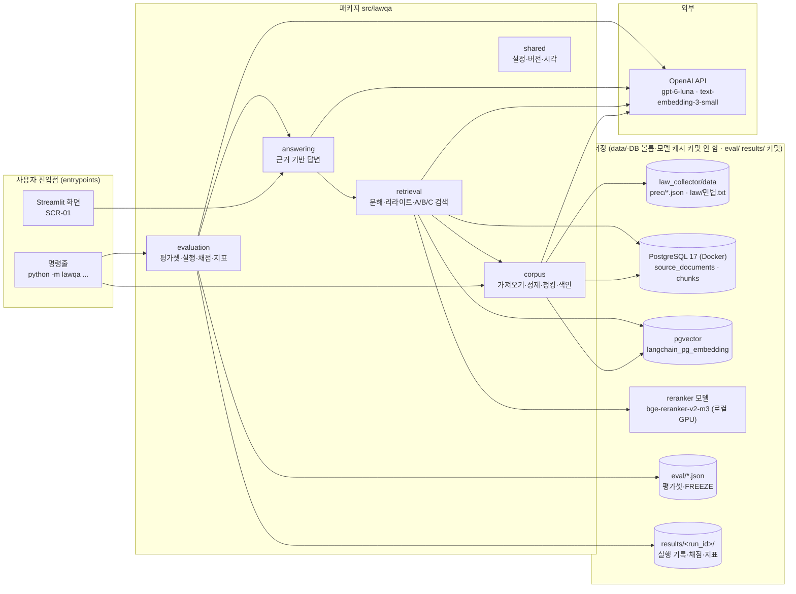

# 02. 시스템 아키텍처 (C1)

## 1. 구성도

- 모듈 간 의존은 한 방향 `evaluation → answering → retrieval → corpus`(ADR-001). `evaluation`만 `eval/`의 정답을 읽는다(INV-04).

## 2. 기술 스택

| 영역 | 선택 | 버전 | 근거 |
|---|---|---|---|
| 언어 | Python | 3.12 | C-01, ADR-005 |
| 패키지·환경 | uv, `pyproject.toml`, `uv.lock` | uv 최신 | ADR-005 |
| LLM 오케스트레이션 | langchain, langchain-core, langchain-openai | 1.5.x / 1.8.x / 1.8.x (조사 2026-11-23) | C-01, 프로파일 §8 |
| 생성·리라이트·LLM 채점 | OpenAI `gpt-6-luna` (구조화 출력) | API 모델 | C-02 |
| 임베딩 | OpenAI `text-embedding-3-small` (1536차원), `OpenAIEmbeddings` | API 모델 | ADR-008 |
| 벡터 검색 | langchain-postgres `PGVector` (pgvector 확장, psycopg 3) | 버전은 uv.lock(미확인) | ADR-006, ADR-009 |
| 결합·재정렬 | langchain-classic `EnsembleRetriever`(가중 RRF), `ContextualCompressionRetriever`, `CrossEncoderReranker` | 1.0.x | ADR-009, ADR-010 |
| BM25 | langchain-community `BM25Retriever` + kiwipiepy | 0.4.x / 0.25.x | ADR-009 |
| reranker 모델 | `BAAI/bge-reranker-v2-m3` via langchain-community `HuggingFaceCrossEncoder`(sentence-transformers), PyTorch(CUDA) | 6.3.x / PyTorch는 RTX 50 지원 버전(A6 스택 주의) | ADR-010 |
| 원문·청크 저장 | PostgreSQL 17 (Docker Compose), psycopg 3(동기) + SQL | 이미지 `pgvector/pgvector:pg17` | ADR-006 |
| 컨테이너 실행 | Docker Desktop + Compose | 29.x / v5.x (이 PC 확인) | ADR-006 |
| 설정 | `.env` + python-dotenv, `config/*.toml`(`tomllib`) | — | ADR-003 |
| 화면 | Streamlit | 1.67.x | ADR-012, C-10, 프로파일 §8 |
| 테스트·린트 | pytest, ruff | — | ADR-005 |

## 3. 기능 모듈

| 모듈 | 책임 | 관련 US | 정답 데이터 접근 |
|---|---|---|---|
| `corpus` | law_collector 출력 가져오기·정제·검증, 원문 저장, 정제·청킹, 임베딩·벡터 색인, BM25 토큰 | US-03, US-05 | 금지 |
| `retrieval` | 문항 분해, 쿼리 리라이트, 구성 A/B/C 검색, RRF 결합, 재정렬, 문항 목록 합침 | US-06~08, US-10 | 금지 |
| `answering` | 프롬프트 구성, 생성 호출, 출력 검증(인용·근거 부족), `Answer` 결과 | US-09, US-11 | 금지 |
| `evaluation` | 평가셋 로드·검증, 성공 기준·고정 기록, 일괄 실행, 기록, LLM 채점·사람 검토, 지표 | US-02, US-04, US-12~15 | 허용(유일) |
| `shared` | 설정 읽기, 버전 해시, 현재 시각 제공 | 전체 | — |
| `entrypoints` | 명령줄(`__main__`), Streamlit 화면 | US-05, 11, 13~16 | 명령만 연결 |

## 4. ADR 목록

| ADR | 결정 영역 | 출처 | 상태 | 이유 |
|---|---|---|---|---|
| ADR-001 | 기능 모듈 분할과 모듈 간 참조 | 코어 | Accepted | 규칙 시험·정답 누출 차단 |
| ADR-002 | 인증·권한 | 코어 | 해당 없음 | TR-01 해당 없음 |
| ADR-003 | 설정·비밀값 | 코어+TR-08 | Accepted | 비밀값 2종, 실험 설정 버전화 |
| ADR-004 | 오류 형식(결과 종류·변환 위치) | 코어 | Accepted | 오류/근거 부족 분리 |
| ADR-005 | 개발 도구·환경 | 코어+TR-13 | Accepted | 재현 설치(이 PC에 Python 없음) |
| ADR-006 | 영속 계층(PostgreSQL·pgvector·psycopg 3) | 코어+TR-07 | Accepted | 사용자 선택 C |
| ADR-007 | 원문 확보(별도 수집 파일 가져오기) | TR-07 | Superseded by ADR-015 | — |
| ADR-008 | 임베딩 모델 | 기타(C-03) | Accepted | 협의 제약 |
| ADR-009 | 검색기 구성(BM25+PGVector→Ensemble) | 기타(C-03), C-05 | Accepted | 협의 제약 |
| ADR-010 | reranker | 기타(C-03) | Accepted | 협의 제약 |
| ADR-011 | 검색 파이프라인(분해·결합·Hit@5 목록) | 기타(U-2, AQ-015) | Accepted | 문항 통째 입력 |
| ADR-012 | 실행 인터페이스 | TR-09, C-10 | Accepted | "A 또는 B" 제약 |
| ADR-013 | 답변 생성·근거 부족 판정 | 기타(U-1, U-3) | Accepted | 환각 인용 차단 |
| ADR-014 | 평가 실행·채점·고정 기록 | TR-06, 기타(U-2) | Accepted | 평가 무결성 |
| ADR-015 | 원문 가져오기: 수집 판례 JSON·민법 텍스트 직접 읽기(데이터출처 대법원 민사 전부, 민법만) | TR-07 | Accepted | 사용자 선택 A |
| — | 외부 연동 어댑터 경계·시험용 대역 | TR-08 | 선택지 없음 → ADR-001 `infrastructure` + A5 | 모듈 계층 구조로 정해짐 |
| — | 화면 데이터 계약·갱신 방식 | TR-09 | 선택지 없음 → A4 PAGE-01 | Streamlit은 요청마다 다시 그림 |
| — | 캐시 방식·무효화 | TR-12 | 해당 없음 | 캐싱은 선택 등급(D-005) |
| — | 성능 측정 조건 | TR-12 | 선택지 없음 → A7 | NFR-02 정의대로 |
| — | 배포 구성 | TR-13 | 선택지 없음 → ADR-005 로컬 실행 | 웹 배포는 선택 등급 |
| — | 쿼리 리라이트 세부 | 기타(C-07) | PM 규칙 D-005 → A4·A5 | 필수 최적화로 확정 |
| — | 일괄 실행 방식(가져오기·색인) | TR-06 | 선택지 없음 → A5 SEQ | 멱등 가져오기 |
