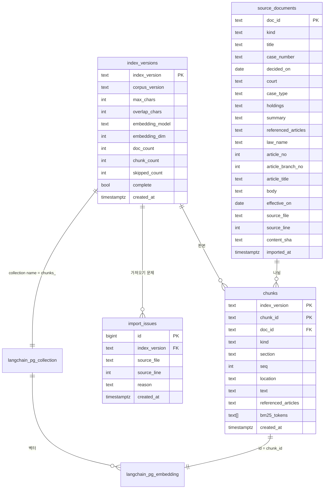

# 03. 도메인 모델 & DB 스키마 (C1)

> 저장소: PostgreSQL 17 + pgvector (Docker, ADR-006). 데이터 접근: psycopg 3 동기 + SQL. 벡터: langchain-postgres `PGVector`가 관리하는 표(ADR-009). 평가셋·실행 기록은 DB가 아니라 커밋 파일(§5).

## 1. 엔티티

| ENT | 도메인 클래스 (모듈) | 저장 위치 | PM 용어 |
|---|---|---|---|
| ENT-01 | `SourceDocument` (`corpus.domain`) | 표 `source_documents` | 원문 문서 |
| ENT-02 | `Chunk`, `SourceLocation` (`corpus.domain`) | 표 `chunks` | 청크, 원문 위치 |
| ENT-03 | `IndexVersion` (`corpus.domain`) | 표 `index_versions` | 코퍼스·색인 버전 |
| ENT-04 | `ImportIssue` (`corpus.domain`) | 표 `import_issues` | (가져오기 건너뜀 기록, REJ-06) |
| ENT-05 | (벡터) | `langchain_pg_collection`, `langchain_pg_embedding` (PGVector 관리) | 색인 |
| ENT-06 | `EvalQuestion`, `EvalSet` (`evaluation.domain`) | 파일 `eval/dev.json`, `eval/test.json` | 평가 문항·평가셋 |
| ENT-07 | `SuccessCriteria`, `FreezeRecord` (`evaluation.domain`) | 파일 `eval/success_criteria.json`, `eval/FREEZE.json` | 성공 기준·고정 |
| ENT-08 | `Run`, `RunRecord` (`evaluation.domain`) | 파일 `results/<run_id>/run.json`, `records.jsonl` | 실행·실행 기록 |
| ENT-09 | `Grade` (`evaluation.domain`) | 파일 `results/<run_id>/grades.jsonl`, `review.csv` | 채점 |
| — | `ExamItem`, `Answer`, `Citation`, `Candidate` | 저장 안 함(실행 기록 안에 직렬화) | 문항·답변·인용·후보 |

## 2. ERD

## 3. 테이블 정의 (`src/lawqa/corpus/infrastructure/schema.sql`)

### source_documents (ENT-01) — 가져온 원문, 청크·색인을 다시 만들어도 보존
| 컬럼 | 타입 | null | 기본값 | 제약 | 설명 |
|---|---|---|---|---|---|
| doc_id | text | N | — | PK | 판례 `prec:<판례정보일련번호>`, 조문 `law:민법:<조문번호>-<조문가지번호>` |
| kind | text | N | — | CHECK in (`STATUTE_ARTICLE`,`PRECEDENT`) | |
| title | text | N | — | | 판례 = 사건명 없으면 사건번호, 조문 = `민법 제N조(제목)` |
| case_number | text | Y | — | | 판례 `사건번호` |
| decided_on | date | Y | — | | 판례 `선고일자` |
| court | text | Y | — | | 판례 `법원명` |
| case_type | text | Y | — | | 판례 `사건종류명` |
| holdings | text | Y | — | | 판례 `판시사항` |
| summary | text | Y | — | | 판례 `판결요지` |
| referenced_articles | text | Y | — | | 판례 `참조조문` |
| law_name | text | Y | — | | 조문 `법령명` |
| article_no | integer | Y | — | | 조문 `조문번호` |
| article_branch_no | integer | Y | 0 | | 조문 `조문가지번호` |
| article_title | text | Y | — | | 조문 `조문제목` |
| body | text | Y | — | | 조문 `조문내용` |
| effective_on | date | Y | — | | 조문 `시행일자` |
| source_file | text | N | — | | `raw_dir` 기준 파일 경로(`prec/123456.json`, `law/민법.txt`) |
| source_line | integer | N | — | | 판례 1, 조문은 `민법.txt`의 조 머리 줄 번호 |
| content_sha | text | N | — | | 원문 필드 정규화 후 SHA-256 |
| imported_at | timestamptz | N | now() | | |
- CHECK: `kind='PRECEDENT'`이면 `holdings` 또는 `summary`가 NOT NULL·비어 있지 않음, `kind='STATUTE_ARTICLE'`이면 `body`·`article_no` NOT NULL.

### index_versions (ENT-03)
| 컬럼 | 타입 | null | 기본값 | 제약 | 설명 |
|---|---|---|---|---|---|
| index_version | text | N | — | PK | `idx-<corpus_version 앞 8자>-<청킹·임베딩 설정 해시 앞 8자>` |
| corpus_version | text | N | — | | 가져온 원문 전체의 `content_sha` 정렬 해시 |
| max_chars | integer | N | — | CHECK > 0 | 청크 최대 글자 수 |
| overlap_chars | integer | N | — | CHECK >= 0 | 긴 청크 분할 겹침 |
| embedding_model | text | N | — | | `text-embedding-3-small` |
| embedding_dim | integer | N | — | | 1536 |
| doc_count | integer | N | 0 | | |
| chunk_count | integer | N | 0 | | |
| skipped_count | integer | N | 0 | | 가져오기 건너뛴 줄 수 |
| complete | boolean | N | false | | 임베딩까지 끝나고 `skipped_count=0`이면 true(REJ-06 "불완전") |
| created_at | timestamptz | N | now() | | |

### chunks (ENT-02)
| 컬럼 | 타입 | null | 기본값 | 제약 | 설명 |
|---|---|---|---|---|---|
| index_version | text | N | — | PK(1), FK → index_versions ON DELETE CASCADE | |
| chunk_id | text | N | — | PK(2) | `<doc_id>#<section>#<seq>` (청킹 규칙이 같으면 판본이 바뀌어도 같음) |
| doc_id | text | N | — | FK → source_documents ON DELETE RESTRICT | |
| kind | text | N | — | CHECK in (`STATUTE_ARTICLE`,`PRECEDENT`) | |
| section | text | N | — | CHECK in (`ARTICLE`,`HOLDING`) | 조문 / 판시사항·판결요지 항목 |
| seq | integer | N | — | CHECK >= 1 | |
| location | text | N | — | | 원문 위치 문자열(§4) |
| text | text | N | — | CHECK length > 0 | 임베딩·BM25·프롬프트에 쓰는 본문 |
| referenced_articles | text | Y | — | | 판례 참조조문(검색 메타데이터) |
| bm25_tokens | text[] | N | — | | Kiwi 내용 형태소 |
| created_at | timestamptz | N | now() | | |
- 색인: `(index_version, doc_id)`.

### import_issues (ENT-04)
| 컬럼 | 타입 | null | 기본값 | 제약 | 설명 |
|---|---|---|---|---|---|
| id | bigint | N | identity | PK | |
| index_version | text | N | — | FK → index_versions ON DELETE CASCADE | |
| source_file | text | N | — | | |
| source_line | integer | N | — | | |
| reason | text | N | — | | `MISSING_FIELD:<필드>`, `BAD_DATE:<필드>`, `JSON_ERROR`, `EMPTY_CONTENT`, `OUT_OF_SCOPE`, `DUPLICATE_ARTICLE` (ADR-015). 삭제 조문·편장절 제목은 이슈가 아니라 보고의 "제외" 건수 |
| created_at | timestamptz | N | now() | | |

### langchain_pg_collection / langchain_pg_embedding (ENT-05)
- `PGVector`가 만들고 관리한다. 우리 스키마 파일에 정의하지 않는다.
- 규칙: 컬렉션 이름 `chunks_<index_version>`, 문서 ID = `chunk_id`, 메타데이터(jsonb) = `{chunk_id, doc_id, kind, section, location, index_version}`. 같은 `index_version`의 `chunks` 행 수 = 임베딩 수(GATE 일치 검사).

## 4. 청킹·원문 위치 규칙 (AQ-004, AQ-007)

| 원문 | 청크 단위 | `section` | `location` 형식 | 예 |
|---|---|---|---|---|
| 민법 조문 | 조문 1개 = 청크 1개. `max_chars` 초과 시 항(①②…) 경계로 나누고 `seq` 증가 | `ARTICLE` | `민법 제{조문번호}조` 또는 `민법 제{조문번호}조의{가지번호}` (+ 나눈 경우 `제{n}항~`) | `민법 제245조` |
| 판례 | 판시사항 `[n]`과 판결요지 `[n]`을 같은 번호끼리 묶어 청크 1개(`seq=n`). 번호 표시가 없으면 판시사항+판결요지 전체가 청크 1개. `max_chars` 초과 시 문장 경계로 나누고 `overlap_chars` 겹침 | `HOLDING` | `대법원 {YYYY. M. D.} 선고 {사건번호} 판결 [{n}]` | `대법원 2019. 1. 31. 선고 2016다215127 판결 [1]` |
- 청크 본문(`text`) 머리에 `location`과 참조조문을 한 줄로 붙인다(검색·인용 모두 같은 문자열).
- 초기값: `max_chars=1500`, `overlap_chars=150`(`config/base.toml [chunking]`, dev로만 조정). 근거: 판결요지 항목 1개는 대개 수백 자라 대부분 나누지 않고, 1,500자는 `text-embedding-3-small` 입력 한도(8,192토큰)보다 충분히 작다.

## 5. 파일 저장 (ENT-06~09, AQ-011)

| 파일 | 형식 | 쓰는 곳 | 읽는 곳 |
|---|---|---|---|
| `eval/dev.json`, `eval/test.json` | `{"version", "split", "questions": [EvalQuestion]}` | 사람(평가셋 작성) | `evaluation`만 |
| `eval/SCHEMA.md` | 필드 설명 | 사람(US-04) | 사람 |
| `eval/success_criteria.json` | `{"priority": ["quality","latency","cost"], "targets": {...D-007}}` | 사람(US-02) | `evaluation` |
| `eval/FREEZE.json` | ADR-014 필드 | `eval freeze` 명령 | `evaluation` |
| `results/<run_id>/run.json` | `Run` 머리 정보 | `eval run` | `eval grade/metrics` |
| `results/<run_id>/records.jsonl` | `RunRecord` 한 줄 = 문항 1건 | `eval run` (건마다 append) | `eval grade/metrics` |
| `results/<run_id>/grades.jsonl` | `Grade`(LLM) | `eval grade` | `eval review/metrics` |
| `results/<run_id>/review.csv` | 질문 ID, LLM 판정 3칸, 사람 판정 3칸, 메모 | `eval grade`가 만들고 사람이 채움 | `eval metrics` |
| `results/<run_id>/metrics.csv`, `results/summary.csv` | 지표 | `eval metrics` | 사람(`report.md`) |

**EvalQuestion 필드**: `question_id`(`DEV-01`~`DEV-10`, `TEST-01`~`TEST-20`), `type`(`direct`|`paraphrase`|`no_evidence`), `source`(`exam:2026:<문번>`|`authored`), `item`(`{"stem", "options": [5개]}`), `expected`(`{"answer": 1..5|null, "key_facts": [문자열], "insufficient": bool}`), `allowed_evidence`(`[{"chunk_id","doc_id","location"}]`, 근거 없음이면 `[]`), `absence_reason`(근거 없음 문항만), `answer_source`(`exam_key:DOC-05`|`human:<근거>`).

**RunRecord 필드**: `run_id`, `kind`(`main`|`warmup`|`retry`|`extra`), `split`, `config_name`(`A`|`B`|`C`|`C+R`), `versions`(`corpus`, `index`, `config_sha`, `prompt_sha`, `gen_model`, `embedding_model`, `reranker_model`), `question_id`, `attempt`, `retry_of`(재시도면 원 `run_id`), `started_at`, `latency_ms`(`total`, `rewrite`, `retrieval`, `rerank`, `generation`), `status`(`OK`|`ERROR`|`TIMEOUT`), `outcome`, `error_code`, `queries`(`[{"option_no","original","rewritten","fallback"}]`), `candidates`(`{"<option_no>": [{"chunk_id","bm25_rank","bm25_score","vector_rank","vector_score","fused_rank","rerank_score","final_rank"}]}`), `question_list`(문항 목록 chunk_id 순서), `context_chunk_ids`, `context_chars`, `raw_output`, `answer`(정규화된 `Answer`), `citations`. 비밀값·API 키는 넣지 않는다.

## 6. 불변 규칙 보호 위치

| INV | 보호 위치 | 이유 |
|---|---|---|
| INV-01 인용 ⊂ 후보 | 도메인(`Answer.from_model_output`) | 실행마다 후보가 달라 DB 제약으로 표현 불가 |
| INV-02 청크의 문서 ID·위치·판본 | 둘 다(도메인 생성자 + NOT NULL·FK) | 가져오기 오류가 색인까지 가지 않게 |
| INV-03 결과 종류 하나 | 도메인(`Answer` 생성자) | 결과는 DB에 저장하지 않음 |
| INV-04 정답 누출 금지 | 구조(ADR-001 모듈 의존) + GATE | 코드 경로 자체를 막음 |
| INV-05 test 개발 사용 금지 | 도메인(`Run.start` 검사) | 파일 저장 |
| INV-06 고정 후 변경 금지 | 도메인(`FreezeRecord.verify`) | 해시 비교 |
| INV-07 기록 삭제 금지·종류 표시 | 응용(append 전용 기록기) + 도메인(`Run.kind`) | 파일 저장 |
| INV-08 같은 모델·프롬프트 | 도메인(`RunPlan` 검사: 구성 간 다른 값은 검색 구성·리라이트뿐) | 설정 비교 |
| INV-09 문서 속 지시문 | 응용(프롬프트 구성) + 시험 AC-09-7 | 모델 동작 |
| INV-10 리라이트 fallback | 도메인(`RewriteResult.fallback`) + 응용 | |
| INV-11 버전 기록 | 도메인(`RunRecord` 생성자 필수 필드) | |
| INV-12 평가셋 구성 30=10+20 | 도메인(`EvalSet` 생성자) | |
| INV-13 근거 부족이면 번호 없음 | 도메인(`Answer`) | |

## 7. 저장 계층 ↔ 도메인 매핑 (ORM 없음)

| 저장 | 도메인 클래스 | 저장소 클래스 (`infrastructure`) | 변환 | 메서드 시그니처 |
|---|---|---|---|---|
| `source_documents` | `SourceDocument` | `corpus.infrastructure.pg_documents.PgSourceDocumentRepository` | `_row_to_document(row) -> SourceDocument` | `upsert_many(docs: list[SourceDocument]) -> int`, `iter_all() -> Iterator[SourceDocument]`, `count() -> int` |
| `index_versions` | `IndexVersion` | `corpus.infrastructure.pg_index.PgIndexVersionRepository` | `_row_to_version(row)` | `save(v: IndexVersion) -> None`, `get(index_version: str) -> IndexVersion \| None`, `mark_complete(index_version: str, chunk_count: int, skipped: int) -> None` |
| `chunks` | `Chunk` | `corpus.infrastructure.pg_chunks.PgChunkRepository` | `_row_to_chunk(row)` | `replace_for_version(index_version: str, chunks: list[Chunk]) -> int`, `list_for_version(index_version: str) -> list[Chunk]`, `get_many(index_version: str, chunk_ids: list[str]) -> list[Chunk]` |
| `import_issues` | `ImportIssue` | `corpus.infrastructure.pg_index.PgImportIssueRepository` | — | `add_many(issues: list[ImportIssue]) -> None`, `count(index_version: str) -> int` |
| PGVector 표 | (벡터) | `corpus.infrastructure.vector_index.PgVectorIndex` | `Chunk → langchain Document`(id·metadata 규칙 §3) | `add_chunks(index_version: str, chunks: list[Chunk]) -> None`, `as_retriever(index_version: str, k: int) -> BaseRetriever`, `count(index_version: str) -> int` |
| `eval/*.json` | `EvalSet` | `evaluation.infrastructure.files.JsonEvalSetRepository` | dict ↔ 도메인 | `load(split: Split) -> EvalSet` |
| `results/<run_id>/` | `Run`, `RunRecord`, `Grade` | `evaluation.infrastructure.files.RunStore` | dict ↔ 도메인 | `create(run: Run) -> None`, `append(record: RunRecord) -> None`, `load(run_id: str) -> tuple[Run, list[RunRecord]]`, `append_grade(g: Grade) -> None` |

- 상위 계층은 도메인 객체만 받는다. `psycopg` 행·LangChain `Document`는 `infrastructure` 밖으로 나가지 않는다(검색기의 `Document`는 `retrieval.infrastructure`에서 `Candidate`로 바꾼다).

## 8. 시드 계획

- 운영 데이터는 시드가 아니라 `law_collector` 수집 결과 가져오기(ADR-015)다.
- 시험용 고정 데이터는 수집기 출력과 같은 모양(ADR-015)으로 둔다: `tests/fixtures/raw/prec/*.json`(`PrecService` 형식 판례 7건: 번호 표시 있는 것 2, 없는 것 1, 판시사항만 1, ` ` 태그 포함 1, **지시문이 든 판례 1**(AC-09-7), 형사 사건 1(`OUT_OF_SCOPE`)), `tests/fixtures/raw/law/민법.txt`(실제 파일에서 발췌: 편·장·절 제목, 한 줄 조문, 머리만 있는 조문+항, `제N조의M`, 대괄호 제목 제50조, 삭제 조문, 호 `1의2.`·삭제 호, `<개정 …>` 표시, 특수 제목 `제1항 협의상 파양`), `tests/fixtures/raw/law/상법.txt`(무시돼야 하는 파일), `tests/fixtures/raw/broken/prec/*.json`(필수 필드 없음 1, 날짜 오류 1, JSON 깨짐 1 — AC-05-4). 값은 실제 공개 판례·조문 문구에서 짧게 발췌한다. 판례 샘플은 실제 수집 파일(2026-11-23 확인, ADR-015)의 형식을 따른다.
- 중복 주입 방지: `ON CONFLICT (doc_id) DO UPDATE`(원문), `replace_for_version`(청크: 같은 판본 삭제 후 삽입).
- 비밀값 입력: 없음(`.env`만).
