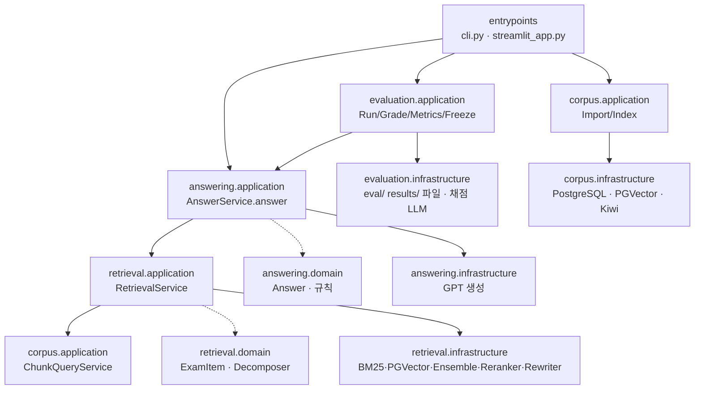

# 05. 디렉토리 구조 & 코딩 컨벤션 (C1)
확인: 확인됨 (user, 2026-11-23)

## 1. 디렉토리 트리 (파일 단위 확정)

```
.
├── AGENTS.md                      # 파이프라인 규칙 + 디렉토리 지도
├── README.md                      # FE 티켓(목차는 HANDOFF)
├── compose.yaml                   # PostgreSQL 17 + pgvector (ADR-006)
├── pyproject.toml / uv.lock / .python-version   # ADR-005
├── .env.example / .gitignore
├── config/
│   ├── base.toml                  # 04-interfaces-api §6
│   └── A.toml  B.toml  C.toml  C+R.toml
├── law_collector/                 # 파이프라인 밖 수집 도구(사람·팀). 출력 data/prec/, data/law/는 커밋 안 함(자체 .gitignore)
│   └── data/prec/*.json  data/law/민법.json   # 가져오기 입력(ADR-015)
├── data/                          # MANIFEST.md만 커밋
│   └── MANIFEST.md                # 사람: 수집 방법·파일 버전·재생성 명령
├── eval/                          # 커밋, evaluation 모듈만 읽음
│   ├── SCHEMA.md  dev.json  test.json  success_criteria.json  FREEZE.json
├── results/<run_id>/              # 커밋: run.json records.jsonl grades.jsonl review.csv metrics.csv
├── docs/problem.md                # 사람(US-01)
├── report.md  contributions.md    # 사람(US-15, US-17)
├── src/lawqa/
│   ├── __init__.py  __main__.py   # __main__ → entrypoints.cli:main
│   ├── shared/
│   │   ├── __init__.py  clock.py  settings.py  versioning.py  logging_setup.py
│   │   └── db.py                  # psycopg 연결 팩토리(DB)
│   ├── corpus/
│   │   ├── domain/       __init__.py models.py chunking.py text_clean.py errors.py ports.py
│   │   ├── application/  __init__.py import_service.py index_service.py chunk_query_service.py
│   │   └── infrastructure/ __init__.py schema.sql collector_reader.py pg_documents.py pg_chunks.py pg_index.py vector_index.py kiwi_tokenizer.py
│   ├── retrieval/
│   │   ├── domain/       __init__.py models.py decomposer.py errors.py ports.py
│   │   ├── application/  __init__.py retrieval_service.py
│   │   └── infrastructure/ __init__.py retrievers.py reranker.py rewriter.py prompts/rewrite.txt
│   ├── answering/
│   │   ├── domain/       __init__.py models.py errors.py ports.py
│   │   ├── application/  __init__.py answer_service.py
│   │   └── infrastructure/ __init__.py generator.py prompts/answer.txt
│   ├── evaluation/
│   │   ├── domain/       __init__.py models.py run.py metrics.py errors.py ports.py
│   │   ├── application/  __init__.py freeze_service.py run_service.py grading_service.py metrics_service.py
│   │   └── infrastructure/ __init__.py files.py judge.py prompts/judge.txt
│   └── entrypoints/      __init__.py cli.py streamlit_app.py
└── tests/
    ├── conftest.py                # DB: lawqa_test 스키마 픽스처, 가짜 어댑터 공용
    ├── fixtures/raw/              # DB: 03-db-schema §8 시험 데이터
    ├── fixtures/eval/             # BE: 작은 평가셋(DEV 10·TEST 20 형식, 가짜 내용)
    ├── unit/<module>/test_*.py    # BE: 도메인·응용(가짜 어댑터)
    ├── integration/db/test_*.py   # DB: 저장소·스키마·PGVector(Docker DB 필요)
    └── acceptance/test_ac_*.py    # QA: AC-xx-n 시험
```
- 모듈 사이 읽기 경로: `retrieval`은 청크를 `corpus.application.ChunkQueryService.list_chunks(index_version) -> list[Chunk]`로 받고, 벡터 검색기는 `retrieval.infrastructure.retrievers`가 `PGVector`를 직접 만든다(컬렉션 이름은 `corpus.domain.models.IndexVersion.collection_name()`).

## 2. 요청 처리 흐름도 (문서·발표 원본)



## 3. 의존 방향
- 모듈 안: `entrypoints → application → domain`, `infrastructure → domain`. `domain`은 표준 라이브러리와 `lawqa.shared.versioning`만 import.
- 모듈 사이(한 방향): `evaluation → answering → retrieval → corpus`, 모두 `shared` 사용 가능. 다른 모듈의 `application`·`domain`만 import, 다른 모듈의 `infrastructure` import 금지.
- `entrypoints`는 모든 모듈의 `application`과 각 모듈 `infrastructure`의 조립 함수(`build_*`)만 import.
- 정답 데이터(`eval/`)를 읽는 코드는 `evaluation.infrastructure.files`뿐. `corpus`·`retrieval`·`answering`에서 `evaluation` import 금지(INV-04).

## 4. 코딩 컨벤션 (CONV)
| CONV | 규칙 |
|---|---|
| CONV-01 | 파일·모듈 snake_case, 클래스 PascalCase, 함수·변수 snake_case, 상수 UPPER_SNAKE. 이름은 04-interfaces-api 확정본 |
| CONV-02 | 도메인 객체는 `@dataclass(frozen=True, slots=True)`, 열거형은 `StrEnum`. 검증은 `__post_init__` |
| CONV-03 | 저장소 클래스 `Pg<Entity>Repository`, 계약은 `ports.py`의 `Protocol`, 응용 서비스 `<Name>Service`, 조립 함수 `build_<name>(settings) -> <Name>Service`(각 모듈 `infrastructure/__init__.py`) |
| CONV-04 | 동기 코드만(비동기 없음). DB는 `psycopg` 3, 연결은 응용 서비스가 열고 저장소에 넘김 |
| CONV-05 | SQL은 `%s` 매개변수만(문자열 연결 금지). 스키마는 `schema.sql` 한 곳 |
| CONV-06 | 명령줄은 표준 `argparse`, `python -m lawqa <group> <command>`(04-interfaces-api §3). 종료 코드 0/1/2/3 |
| CONV-07 | 로그 한 줄 `ts level module event key=value`, 비밀값·`DATABASE_URL` 금지 |
| CONV-08 | 시험 이름 `test_<대상>_<조건>_<기대>`. 수용 기준 시험은 함수 이름에 AC ID: `test_ac_09_3_out_of_scope_item_is_insufficient` |
| CONV-09 | 프롬프트는 `.txt` 파일, 코드에 문자열로 두지 않음(해시 = `prompt_sha`) |
| CONV-10 | 설정 값은 `Settings`로만 읽음(`os.environ` 직접 읽기는 `shared/settings.py`만) |

## 5. 금지 패턴
1. `*/domain/*.py`에서 표준 라이브러리 외 import(`langchain*`, `psycopg`, `openai`, `streamlit`, `kiwipiepy`, `sentence_transformers`, `torch` 등)
2. `domain`에서 `application`·`infrastructure`·`entrypoints` import, `application`에서 `entrypoints` import, 다른 모듈의 `infrastructure` import, 모듈 의존 역방향(`corpus → retrieval` 등)
3. `infrastructure` 밖으로 `psycopg` 행·커서, LangChain `Document` 반환. `entrypoints`에서 SQL 실행
4. `application`·`entrypoints`에 업무 규칙 조건문(결과 판정·인용 검증·실행 허용 검사는 도메인 메서드)
5. 빈 `except`, 예외 삼키기(`AnswerService`의 최종 변환은 `log.exception` 후 결과로 변환 — 유일한 예외)
6. API 키·DB 비밀번호 하드코딩, `.env` 커밋
7. 실행 기록·화면·로그에 비밀값 포함
8. 허용 목록(02-system-architecture §2) 밖 패키지 추가, 코어 버전 변경(ADR 필요)
9. 주석 처리된 옛 코드, 쓰지 않는 파일
10. 기능 변경과 구조 리팩토링을 한 커밋에
11. 도메인 메서드 안에서 현재 시각·DB·HTTP·모델 호출
12. `corpus`·`retrieval`·`answering`에서 `eval/` 경로·`evaluation` 모듈 접근(정답 누출)
13. `results/` 기존 줄 수정·삭제(append 전용)

## 6. 스택 주의 (IC-12) — 출처 확인일 2026-11-23
| # | 주의 | 출처·상태 |
|---|---|---|
| S-01 | langchain 1.x에서 `EnsembleRetriever`, `ContextualCompressionRetriever`, `CrossEncoderReranker`는 `langchain_classic`에 있다(`langchain`에서 import하면 실패) | docs.langchain.com cross_encoder_reranker(조사). `EnsembleRetriever` 위치는 (미확인) → 첫 BE 티켓에서 import로 확인 |
| S-02 | `BM25Retriever`(langchain_community)는 `rank_bm25` 패키지가 필요하고 기본 토큰화가 공백 분리 → `preprocess_func=kiwi_tokenize` 필수 | langchain-community 0.4.2 소스(조사) |
| S-03 | `PGVector`(langchain-postgres)는 SQLAlchemy URL `postgresql+psycopg://...`(psycopg 3 드라이버)를 쓴다. `use_jsonb=True` 권장 | (미확인) → TKT-DB 첫 실행에서 확인 |
| S-04 | `CrossEncoderReranker`는 점수를 `Document.metadata`에 넣지 않을 수 있다 → 기록용 점수는 `HuggingFaceCrossEncoder.score()`로 따로 구함 | (미확인) |
| S-05 | RTX 50 계열(Blackwell) GPU는 CUDA 12.8 이상으로 빌드된 PyTorch가 필요하다. uv에서 PyTorch CUDA 인덱스를 `[tool.uv.sources]`·`[[tool.uv.index]]`로 지정해야 기본 CPU 빌드가 깔리지 않는다 | (미확인) → `check smoke`(API-04)가 `torch.cuda.is_available()`와 장치 이름 출력 |
| S-06 | `gpt-6-luna`: Chat Completions에서 function calling은 `reasoning.effort=none`일 때만 지원, structured outputs는 지원 → `with_structured_output(method="json_schema")` 사용 | developers.openai.com/api/docs/models/gpt-6-luna (조사) |
| S-07 | `kiwipiepy` 0.25.1은 Windows 휠 제공, 첫 실행 시 모델 로드 시간 있음 → 토크나이저는 프로세스당 1회 생성 | PyPI(조사) |
| S-08 | Windows에서 `psycopg`는 `psycopg[binary]`로 설치(로컬 libpq 불필요) | (미확인) |
| S-09 | Python 3.12 고정: langchain 1.5·langchain-core 1.8·streamlit 1.67은 3.11 이상, 모두 3.12 지원 | PyPI 메타데이터(조사) |
| S-10 | `bge-reranker-v2-m3` 첫 다운로드 약 2.3GB → Hugging Face 캐시(저장소 밖) | huggingface.co/BAAI/bge-reranker-v2-m3(조사) |

## 7. 버전 관리 제외 (`.gitignore`, BE 골격 티켓)
`.venv/`, `__pycache__/`, `*.pyc`, `.pytest_cache/`, `.ruff_cache/`, `.env`, `data/*`(예외 `!data/MANIFEST.md`). `law_collector/`의 수집 결과는 그 폴더의 `.gitignore`가 이미 제외, `.streamlit/secrets.toml`. `eval/`·`results/`는 커밋 대상.

## 8. 환경변수 (`.env.example`, 이름과 용도만)
- `OPENAI_API_KEY` — 생성·리라이트·채점·임베딩
- `POSTGRES_PASSWORD` — compose.yaml이 `${POSTGRES_PASSWORD}`로 읽음(비밀번호를 compose 파일에 쓰지 않음)
- `DATABASE_URL` — 형식 `postgresql://lawqa:<POSTGRES_PASSWORD>@localhost:5432/lawqa` (로컬 Docker)
- `DATABASE_URL_TEST` — 시험용 `lawqa_test`
- `HF_HOME` — (선택) reranker 모델 캐시 위치

## 개정
- 2026-11-23: ADR-015(수집기 출력 가져오기)로 트리·제외 목록 세부 수정(§2-8 ②): `law_collector/` 추가, `data/raw` 제거, `text_clean.py`·`collector_reader.py`.
