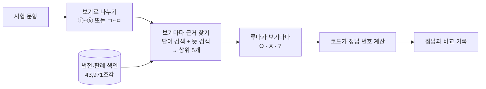

# 민사법 RAG 코드 리뷰 (v2)

> 변호사시험 민사법 선택형 문제를 법전과 판례를 찾아보며 푸는 AI입니다. 처음 보는 팀원도 따라올 수 있게 큰 그림, 실제 예시, 세부 코드 순서로 정리했습니다.
>
> 브랜치 `sanghyuk` · 리뷰 대상 **v2 코드** (커밋 `f36e477`) · 모델 `gpt-6-luna` · 작성 2026-11-25
> 웹 버전: https://claude.ai/artifact/SD8BfuVGMxAgnttDDp8JcM

## 목차
1. [30초 요약](#1-30초-요약)
2. [결과 한눈에](#2-결과-한눈에)
3. [큰 그림: 4단계](#3-큰-그림-4단계)
4. [실제 예시: 문 47이 풀리는 과정](#4-실제-예시-문-47이-풀리는-과정)
5. [자주 나오는 용어](#5-자주-나오는-용어)
6. [왜 이렇게 만들었나](#6-왜-이렇게-만들었나)
7. [파일 안내](#7-파일-안내)
8. [담당별 리뷰 체크리스트](#8-담당별-리뷰-체크리스트)
9. [직접 돌려보기](#9-직접-돌려보기)
10. [v2의 한계와 다음 단계](#10-v2의-한계와-다음-단계)

---

## 1. 30초 요약

**수험생이 법전과 판례집을 펴 놓고, 보기마다 찾아보고 O·X를 친 다음 답을 고르는 과정을 그대로 코드로 만들었습니다.**

AI(루나)에게 문제만 주면 기억에 의존해 그럴듯하게 틀립니다. 변호사시험에는 숫자 바꾸기나 예외 숨기기 같은 함정이 많아서 더 그렇습니다. 그래서 다음 두 가지를 했습니다.

- **보기마다 관련 조문·판례를 먼저 찾아서** 함께 보여 줍니다.
- **근거가 없으면 "모르겠다"고 답하게** 했습니다.

## 2. 결과 한눈에

2026 제15회 변호사시험 민사법 70문항을 같은 AI로 두 번 풀었습니다. 한 번은 근거를 찾아 주고(RAG), 한 번은 근거 없이(closed-book) 풀었습니다.

| | 근거를 찾아 주고 (RAG v2) | 근거 없이 기억으로만 (closed-book) |
|---|---:|---:|
| 정답 | **58 / 70 (82.9%)** | 40 / 70 (57.1%) |
| 확신을 갖고 틀린 보기 | **10** | 57 |

### 확신을 갖고 틀린 보기 10 vs 57

AI는 보기(①~⑤, ㄱ~ㅁ)마다 "맞다 / 틀리다"로 단정합니다. 근거가 부족하면 "모르겠다(판단 유보)"고 답합니다. 70문항의 보기 315개를 세 칸으로 나눴습니다.

| 구성 | 정답 | 판단 유보 | 단정했는데 틀림 |
|---|---:|---:|---:|
| RAG v2 | 252 | 53 | **10** |
| closed-book | 258 | 0 | **57** |

- **근거 없이 풀면 모든 보기를 단정했습니다.** 틀린 57개의 평균 확신도는 0.90이고, 그중 33개는 0.9 이상이었습니다.
- **근거를 찾아 주면 모를 때 유보합니다.** 그래서 확신을 갖고 틀린 보기가 82% 적습니다.
- 맞힌 보기 수는 근거 없이 푼 쪽이 조금 많습니다. 유보한 53개를 정답으로 세지 않기 때문입니다.

> 두 결과 모두 test 17문항이 섞인 탐색 실행입니다. 최종 수치는 고정한 평가셋으로 따로 냅니다. 상세 분석: [`docs/analysis/report-all70.md`](analysis/report-all70.md)

## 3. 큰 그림: 4단계

코드는 네 단계로 나뉩니다. 1단계는 한 번만 해 두면 되고, 문제를 풀 때는 2~4단계가 돕니다.

| 단계 | 하는 일 | 사람으로 치면 | 코드 |
|---|---|---|---|
| **1 준비** | 법령 13개와 대법원 민사 판례를 받아 조문 하나·판결요지 항목 하나씩 잘게 나누고(청크 43,971개) 검색용 색인을 만듭니다 | 법전을 사고 판례집에 색인 탭을 붙이는 일 | `ingest/` · 명령 `build-index` |
| **2 찾기** | 보기 하나하나를 검색어로 바꿔 단어 검색과 뜻 검색을 함께 돌리고, 가장 관련 있는 5개로 추립니다 | 보기 하나 읽고 법전·판례집 뒤적이기 | `retrieval/` |
| **3 판단** | 찾은 근거를 함께 주고, 루나에게 보기마다 맞다/틀리다/모르겠다와 확신도, 근거 번호를 받습니다 | 찾은 조문을 보고 보기 옆에 O·X·? 표시 | `mcq/solver.py` · `mcq/prompts.py` |
| **4 답·채점** | AI는 번호를 직접 고르지 않습니다. O·X 결과로 코드가 번호를 계산하고, 정답과 비교해 기록을 남깁니다 | O·X 표시를 보고 정답 번호 마킹, 채점 | `choose_answer()` · `mcq/evaluate.py` |



## 4. 실제 예시: 문 47이 풀리는 과정

v2 실행 기록(`results/20261124-124149-all70-v2`)에서 그대로 가져왔습니다.

> **문 47.** 「민법」상 조합 및 비법인사단에 관한 설명 중 옳은 것을 모두 고른 것은?
>
> - **ㄱ** 관리단이 입주자대표회의에 공용부분 변경 업무를 포괄 위임하면, 입주자대표회의가 자기 이름으로 체납 비용을 청구할 수 있다.
> - **ㄴ** 조합계약으로 업무집행자를 정하지 않았으면 조합원 3분의 2 이상 찬성으로 선임한다.
> - **ㄷ** 비법인사단의 구성원이 없어져도 곧바로 소멸하지 않고, 청산이 끝나야 당사자능력이 소멸한다.
> - **ㄹ** 조합원 1인의 합유지분 포기가 적법하면 나머지에게 균분 귀속하지만, 등기해야 효력이 있다.
>
> ① ㄴ,ㄷ  ② ㄷ,ㄹ  ③ ㄱ,ㄴ,ㄹ  ④ ㄱ,ㄷ,ㄹ  ⑤ ㄱ,ㄴ,ㄷ,ㄹ  · **정답 ⑤**

**① 보기로 나누기** (`parse.py`)
"옳은 것을 모두 고른 것은"이므로 조합형이고, 찾는 것은 **옳은 것**입니다. 판단할 보기는 ㄱ·ㄴ·ㄷ·ㄹ 네 개입니다.

**② 보기마다 근거 찾기** (`Retriever.retrieve()`, 문항 전체 5.5초)
ㄴ의 검색어는 발문 + ㄴ 문장입니다. 찾은 5개 중 1위가 `LAW-CIVIL#제706조`(민법 제706조, 조합 업무집행자 선임)입니다. 나머지 보기도 각자 따로 찾습니다.

**③ 루나가 O·X 치기** (`_judge()`, 11.5초)

| 보기 | 판단 | 근거·이유 |
|---|---|---|
| ㄱ | 모르겠다 | 판례는 특정 방법(특별결의 등)으로 위임한 경우를 말하는데 보기에 그 조건이 없음 |
| ㄴ | 맞다 (1.0) | 민법 제706조 "3분의 2 이상" |
| ㄷ | 맞다 (1.0) | 판례 92다23087 |
| ㄹ | 맞다 (1.0) | 판례 96다16896 |

**④ 코드가 정답 번호 계산** (`choose_answer()`)
- ㄴ·ㄷ·ㄹ을 확신을 갖고 "맞다"고 했습니다. 그래서 이 셋 중 하나라도 빠진 ①②③④는 점수가 0입니다.
- ⑤만 남습니다. 모르는 ㄱ은 반반(0.5)으로 쳐서 ⑤의 점수는 0.5입니다.
- **예측 ⑤로 정답입니다.**

같은 문항을 근거 없이 풀었더니 ㄴ을 "틀리다(확신도 0.99, 과반수로 정한다)"로 잘못 기억해 ②를 골랐습니다. ㄱ을 몰라도 나머지가 확실하면 답이 나온다는 것이 이 방식의 장점입니다.

## 5. 자주 나오는 용어

| 용어 | 뜻 |
|---|---|
| **RAG** | 검색 증강 생성. AI가 답하기 전에 관련 문서를 찾아서 같이 보여 주는 방식입니다. 오픈북 시험과 같습니다. |
| **closed-book** | 검색 없이 AI 기억으로만 푸는 비교용 실행입니다. 나머지 조건이 모두 같아서 점수 차이가 곧 검색의 효과입니다. |
| **청크** | 검색 단위로 잘라 둔 조각입니다. 조문 1개(`LAW-CIVIL#제706조`) 또는 판결요지 항목 1개(`CASE#92다23087#1`)입니다. |
| **BM25** | 단어가 겹치는 정도로 찾는 검색입니다. "3분의 2", "제706조"처럼 정확한 표현에 강합니다. |
| **벡터 검색** | 문장의 뜻을 숫자로 바꿔(bge-m3) 비슷한 뜻을 찾는 검색입니다. 표현이 달라도 찾습니다. |
| **RRF** | 두 검색 결과를 점수가 아니라 순위로 합치는 방법입니다. 두 검색의 점수 단위가 달라서 이렇게 합칩니다. |
| **리랭커** | 합친 후보 20개를 보기와 하나씩 다시 비교해 순서를 다시 매기는 모델(bge-reranker)입니다. 마지막 5개를 고릅니다. |
| **구성 A / B / C** | A는 뜻 검색만, B는 단어+뜻 검색, C는 B에 리랭커까지 쓴 구성입니다. v2 결과는 C입니다. |
| **판단 유보 (unknown)** | 근거에 없어서 AI가 "모르겠다"고 한 보기입니다. 답 계산에서는 반반(0.5)으로 칩니다. |
| **Hit@5** | 정답 근거가 찾은 5개 안에 들었는지를 봅니다. 검색이 잘 됐는지 보는 지표입니다. |
| **dev / test** | dev 8문항은 고치면서 확인하는 용도이고, test 17문항은 최종 채점용입니다(test 결과를 보고 고치면 안 됩니다). 나머지 45문항은 추가 실험용입니다. |

## 6. 왜 이렇게 만들었나

리뷰할 때 "왜"부터 보면 빠릅니다. 동의하지 않는 결정은 코멘트로 남겨 주세요.

| 결정 | 이유 | 위치 |
|---|---|---|
| **AI는 번호를 고르지 않고 보기마다 O·X만 칩니다** | 틀렸을 때 "못 찾았나, 잘못 판단했나, 번호 계산이 틀렸나"를 나눠 볼 수 있습니다. v2 오답 12문항 중 번호 계산 실수는 0건이었습니다. | `mcq/solver.py::choose_answer` |
| **보기마다 따로 검색합니다** | 보기 다섯 개는 서로 다른 법리를 묻습니다. 문제 전체로 한 번 찾으면 근거가 한두 쟁점에 몰립니다. | `MCQSolver.solve` |
| **근거에 없으면 "모르겠다"를 허용합니다** | 이 프로젝트의 주제가 "AI가 확신을 갖고 틀리는 문제"입니다. 틀린 단정보다 유보가 낫습니다. 프로그램 오류도 "모르겠다"와 섞이지 않게 상태를 따로 기록합니다. | `status`: `ok` · `insufficient_evidence` · `retrieval_error` · `generation_error` · `invalid_citation` |
| **시험일 기준 법령, 2025년까지의 대법원 판례만 씁니다** | 시험 뒤에 바뀐 법이나 하급심·형사 판례가 섞이면 오히려 헷갈립니다. | `configs/default.yaml` · `corpus.*` |
| **판례 수집에 시험 문장을 쓰지 않습니다** | 시험 보기로 판례를 찾아 넣으면 정답을 미리 넣는 셈입니다. 법령 목차(편·장·절·조문 제목)를 검색어로 썼습니다. | `ingest/cases.py::build_topics` |
| **실행할 때마다 설정·버전·커밋을 남깁니다** | 결과 폴더만 보고도 어떤 코드·색인·프롬프트로 나온 숫자인지 알 수 있어야 비교할 수 있습니다. | `results/<실행>/summary.json` |

## 7. 파일 안내

모든 코드는 `src/kant_rag/` 아래에 있고, 위 4단계와 같은 순서로 폴더가 나뉩니다. 설정은 `configs/default.yaml` 한 곳에서 바꿉니다.

| 단계 | 폴더 | 한 줄 설명 |
|---|---|---|
| 1 준비 | `ingest/` | 법령·판례 받기, 조각내기, 색인 만들기 |
| 2 찾기 | `retrieval/` | 단어 검색, 뜻 검색, 합치기, 리랭커 |
| 3 판단 | `mcq/` · `generation/` | 문제 읽기, AI 호출, O·X 받기 |
| 4 답·채점 | `mcq/evaluate.py` | 번호 계산, 정답 비교, 결과 저장 |
| 입구 | `cli.py` · `app/` | `kant-rag` 명령, 화면 |

<details>
<summary><b>파일별 상세 (줄 수는 v2 기준)</b></summary>

| 파일 | 하는 일 | 핵심 함수 | 줄 |
|---|---|---|---:|
| **1 준비 · `ingest/`** | | | |
| `lawapi.py` | 국가법령정보센터 API. 시험일 기준 법령 버전, 판례 검색·필터 | `find_law` | 138 |
| `cases.py` | 판례 검색어(법령 목차) 만들기, 판례 수집, 판결요지 항목별로 자르기 | `chunk_cases` | 171 |
| `case_import.py` | 팀원이 받은 판례 42,537건 합치기 (민사·가사·대법원만) | `import_cases` | 118 |
| `statute.py` · `split.py` | 조문 단위로 자르기, 1,000자 넘으면 문장 단위로 나누기 | `chunk_statute` | 136 |
| `build_index.py` 외 | 조각 → 단어 검색 색인 + 뜻 검색 색인 | `build_index` | 255 |
| **2 찾기 · `retrieval/`** | | | |
| `pipeline.py` | 구성 A/B/C와 closed-book 고르기 | `Retriever.retrieve` | 63 |
| `bm25.py` · `tokenizer.py` | 단어 검색 | `BM25Index` | 80 |
| `vector.py` | 뜻 검색 (bge-m3, GPU) | `get_embeddings` | 86 |
| `hybrid.py` · `rerank.py` | 순위로 합치기(RRF), 리랭커로 다시 줄 세우기 | `rrf_fuse` | 79 |
| **3 판단 · `mcq/` · `generation/`** | | | |
| `mcq/solver.py` | 한 문항 풀기의 전체 흐름 (찾기 → 판단 → 번호 계산) | `MCQSolver.solve` | 217 |
| `mcq/prompts.py` | AI에게 주는 지시문 | `MCQ_SYSTEM` | 57 |
| `mcq/parse.py` · `schemas.py` | 시험지 텍스트 → 문항, 형식(단일·조합·O×) 판별 | `parse_exam_text` | 152 |
| `generation/llmcall.py` | 루나 호출, 빈 응답이면 한 번 더, 토큰 기록 | `call_llm` | 82 |
| `agent.py` · `generation/answer.py` | 자유 질문 답하기 (근거 없음 문항 확인용) | `ask` | 196 |
| `optimize/` | 검색어 다시 쓰기(리라이트), 캐시 | `rewrite_query` | 93 |
| **4 답·채점** | | | |
| `mcq/evaluate.py` | 평가 실행, 정답률·Hit@5·함정별 집계, 채점표 | `run_bar_eval` | 176 |
| `mcq/io.py` · `traps.py` | dev/test 나누기, AI 함정 유형 표시 | `split_exam` | 150 |
| **입구** | | | |
| `cli.py` | `kant-rag` 명령 16개 | `main` | 409 |
| `config.py` | 설정 파일 + `.env` 읽기 | `get_settings` | 148 |
| `app/streamlit_app.py` | 화면 (질의응답, 문제 풀기) | — | 79 |

</details>

## 8. 담당별 리뷰 체크리스트

각자 맡은 부분만 보시면 됩니다. 🔴 꼭 확인 · 🟡 검토 필요 · 🟢 참고

### 🔴 문서·색인 (1단계)
- 합친 판례 42,537건에서 민사·가사·대법원·2025년 이전만 남기는 필터(`case_codes`)에 빠진 사건 부호가 없는지 봐 주세요.
- 판결요지의 [1][2] 항목을 따로 잘라서, 전제와 결론이 다른 조각으로 갈라지는 경우가 있습니다(문 9).
- 「민사 및 가사소송의 사물관할에 관한 규칙」 같은 대법원규칙은 아직 없습니다(문 36).

### 🟡 검색·재정렬 (2단계)
- 검색어는 "발문 앞 300자 + 보기"입니다. 사례형 문제는 발문이 길어서 보기마다 같은 근거가 나옵니다. v2 검색 실패의 주원인입니다.
- AI에게는 보기당 근거 4개만 넘기는데 채점은 5개 기준입니다. 그래서 5위에 있던 정답 근거가 빠진 경우가 있습니다(문 8·17).
- 단어 검색 방식(어절 + 2글자 조각)이 조사가 붙은 법률 용어에 충분한지 봐 주세요.

### 🟡 응답·최적화 (3단계)
- "모르겠다" 53개가 조합형·O×형에 몰려서 문항을 잃습니다. 핵심 법리가 있는데도 표현 차이로 유보하는 경향이 있습니다.
- 확신도는 AI의 자기 평가라 확률처럼 믿으면 안 됩니다.
- 루나는 생각하는 데 쓴 분량도 답변 한도에 들어갑니다. 그래서 한도가 작으면 빈 답이 옵니다(4,096 → 16,000으로 올림).

### 🔴 실험·분석 (4단계)
- `eval/test.json`은 아직 고정 전입니다. 70문항 실행에 test가 섞여 있으니, test 결과를 보고 설정을 바꾸지 않습니다.
- 개선은 dev 8 + 추가 45 = 53문항으로만 검증합니다.
- 근거가 맞았는지 사람이 보는 채점(`grading.csv`)은 아직 하지 않았습니다.

### 🟢 통합·재현
- Windows에서는 저장소 폴더 안에서 실행해야 `kant-rag` 명령이 잡힙니다.
- 그래픽카드 메모리가 부족하면 `embedding.batch_size`를 4로 낮춥니다.
- 판례 원본(zip·폴더), `index/`, `.env`는 git에 올리지 않습니다.

## 9. 직접 돌려보기

저장소 폴더에서 실행합니다. `.env`에 `OPENAI_API_KEY`가 필요하고, 색인은 그래픽카드가 있는 PC에서 만듭니다.

```bash
# 설치
uv sync
# 1단계: 색인 만들기 (index/ 는 git에 올리지 않음)
uv run kant-rag build-index
# 2단계만 확인: 검색이 잘 되는지
uv run kant-rag search "조합 업무집행자 선임" --mode hybrid_rerank
# 한 문항 풀어 보기 (문 47)
uv run kant-rag solve data/exam/2026_civil.json 47 --show-answer
# 70문항 전체 (v2 결과 재현)
uv run kant-rag eval data/exam/2026_civil.json --modes hybrid_rerank --label all70-v2
uv run kant-rag eval data/exam/2026_civil.json --modes closed_book --label all70-v2-closedbook
# 테스트
uv run pytest
```

## 10. v2의 한계와 다음 단계

v2가 틀린 이유를 문항별로 분석하고([`docs/analysis/all70-v1.md`](analysis/all70-v1.md), [`all70-v2.md`](analysis/all70-v2.md)), 다음 버전(v3)에서 하나씩 보완했습니다.

| v2가 틀린 이유 | 문항 | v3에서 한 일 |
|---|---|---|
| 긴 사례 지문 때문에 보기별 근거를 못 찾음 | 2, 10, 13, 17, 28, 36 | 보기마다 쟁점·예외 검색어 2개를 AI가 새로 씀 |
| 5위 근거가 AI에게 안 넘어감 | 8, 17 | 보기당 근거 5개 |
| 같은 판결의 다른 항목을 못 봄 | 9 | 같은 판결의 다른 항목도 함께 줌 |
| 준용 조문을 따라가지 못함 | 53 | "준용" 관계를 따라 조문 추가 |
| 지나친 유보, 일반 법리를 잘못 적용 | 13, 19, 28, 43 | AI 지시문 개선 (예외 먼저, 사실관계 확인) |
| 근거 자체가 없음 | 35, 36 | 유보한 보기만 AI 기억으로 채우기 (선택) |

v3 결과(53문항)는 v2 44문항에서 51문항으로 올랐습니다. 자세한 비교는 [`docs/analysis/report-v2-vs-v3.md`](analysis/report-v2-vs-v3.md)에 있습니다. 이번 리뷰 범위는 v2입니다.

**다음 단계**
1. v2 코드 리뷰 → 지적 사항 반영
2. v3 반복 실행으로 최종 구성 확정
3. test 고정 → 최종 실행 (v2 · 최종 구성 · closed-book)
4. 사람 채점 → 최종 보고서 → 제출
